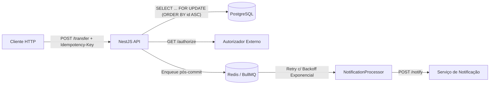

# PicPay Backend Challenge

Implementação do [Desafio Backend PicPay](https://github.com/PicPay/picpay-desafio-backend) construída com **NestJS**, **TypeScript**, **PostgreSQL**, **Prisma ORM**, **Redis** e **BullMQ**, com foco em consistência transacional, prevenção de concorrência (*double-spend* / *deadlock*) e notificações resilientes.

## Arquitetura



## Decisões Técnicas

- **Valores monetários em centavos (`balance_cents`, `amount_cents`):** evita erros de arredondamento de ponto flutuante (`IEEE 754`).
- **Lock Pessimista Ordenado (`SELECT ... FOR UPDATE ORDER BY id ASC`):** garante isolamento contra *double-spend* e evita *deadlocks* em transferências simultâneas cruzadas (`A → B` e `B → A`).
- **Idempotência (`Idempotency-Key`):** retentativas de rede com a mesma chave retornam a transação original sem debitar novamente.
- **Notificação Assíncrona Resiliente (BullMQ):** enfileirada fora da transação SQL, com 5 tentativas e *backoff* exponencial. Indisponibilidade do notificador nunca reverte dinheiro já transferido.
- **Segurança & Qualidade:** senhas com `crypto.scryptSync` + salt aleatório, `ValidationPipe` estrito (`whitelist`, `forbidNonWhitelisted`) e CI com `typecheck`, `Jest` e **Semgrep SAST**.

## Como rodar em 1 comando

```bash
docker compose up --build
```

- **API:** `http://localhost:3000`
- **Swagger (OpenAPI):** `http://localhost:3000/docs`

## Exemplos de uso

```bash
# 1. Criar usuário comum (com saldo inicial de R$ 100,00 = 10000 centavos)
curl -X POST http://localhost:3000/users \
  -H "Content-Type: application/json" \
  -d '{"fullName":"Maria Silva","document":"12345678901","email":"maria@example.com","password":"Password123","type":"COMMON","initialBalanceCents":10000}'

# 2. Criar lojista
curl -X POST http://localhost:3000/users \
  -H "Content-Type: application/json" \
  -d '{"fullName":"Loja Central","document":"12345678000199","email":"loja@example.com","password":"Password123","type":"MERCHANT"}'

# 3. Transferir com Idempotency-Key
curl -X POST http://localhost:3000/transfer \
  -H "Content-Type: application/json" \
  -H "Idempotency-Key: req-001" \
  -d '{"value":25.50,"payer":"<PAYER_UUID>","payee":"<PAYEE_UUID>"}'
```

## Testes locais

```bash
npm install
npx prisma generate
npm run typecheck
npm test
```

## Licença

[MIT](./LICENSE)
